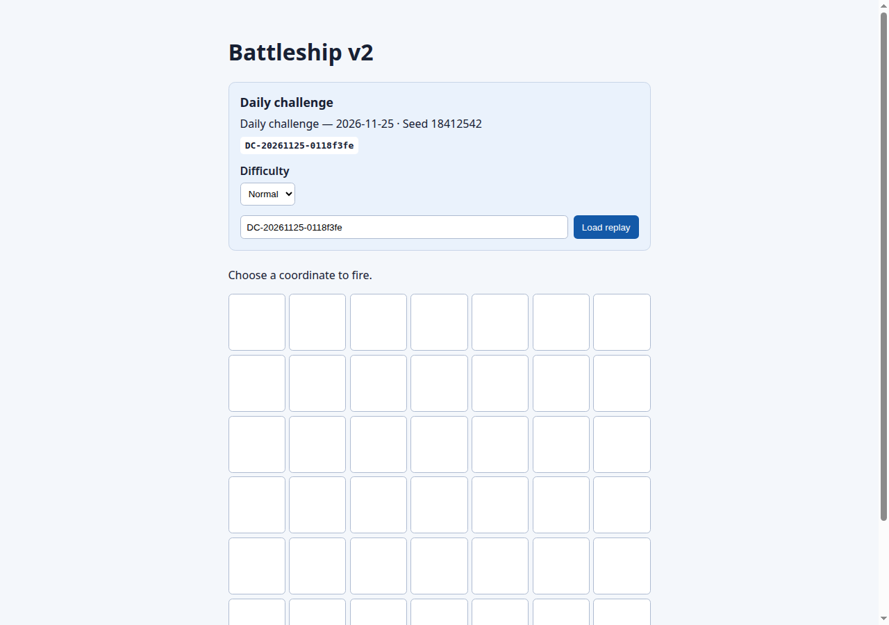

# Battleship

A modern, accessible Battleship game built as a TypeScript monorepo. The application provides deterministic games, daily challenge replay codes, persistent sessions, multiple difficulty levels, and a responsive browser interface.




## Play locally

Requirements:

- Node.js 22 or newer
- pnpm 11.25.0

Install dependencies and start the development server:

```bash
pnpm install
pnpm dev
```

Open the local URL shown by Vite. To create and preview a production build:

```bash
pnpm build
pnpm --filter @battleship/web preview
```

## How to play

Choose a difficulty, select a coordinate on the board, and fire. The board reports hits, misses, repeated shots, sunk ships, and the win state. Difficulty changes start a fresh game using the current challenge.

The daily challenge is deterministic for a UTC calendar date. Use the displayed challenge code to replay the same challenge later or share it with another player. A saved session is restored automatically when the browser supports local storage. If storage is unavailable, the current session continues in memory.

The board uses semantic grid and cell roles, keyboard-friendly controls, row and column metadata, and live status announcements for assistive technology.

## Project structure

```text
apps/web/                  Browser application and accessible UI
packages/game-core/        Typed Battleship rules and deterministic fleets
packages/challenge-core/   Daily challenge dates, seeds, codes, and replay data
tests/                     Regression suite for the released application line
```

The V2 application is composed from the workspace packages. `game-core` is browser-independent and owns game rules, difficulty presets, fleet generation, validation, and firing. `challenge-core` owns UTC challenge identity, deterministic seeds, compact replay codes, and challenge parsing. The web package provides session orchestration, persistence, rendering, and browser integration.

New gameplay features should be implemented in `apps/web` and the V2 workspace packages. The root-level legacy application and its regression suite remain available as a separate preserved line.

## Scripts

| Command | Description |
| --- | --- |
| `pnpm dev` | Start the V2 development server |
| `pnpm build` | Build the V2 production bundle |
| `pnpm --filter @battleship/web preview` | Preview the production bundle |
| `pnpm typecheck` | Type-check every workspace package |
| `pnpm test` | Run all V2 workspace tests |
| `pnpm verify:v2` | Run V2 typecheck, tests, and build |
| `pnpm verify:v1` | Run the preserved regression suite |
| `pnpm release:verify` | Run all release checks |

## Continuous integration

GitHub Actions runs `pnpm release:verify` for pushes to `main` and pull requests targeting `main`. The workflow installs the locked dependency graph, checks all TypeScript packages, runs the V2 tests and production build, and verifies the preserved regression suite.

## Contributing

Create a feature branch, make focused changes, and run `pnpm release:verify` before opening a pull request. Pull requests should include tests for behavior changes and keep the workspace type-safe.

## License

This project is licensed under the [MIT License](LICENSE).
